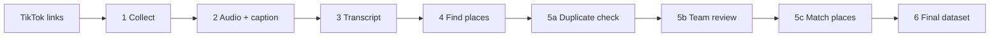

# TVNA data pipeline, explained

_For the project supervisor. Last updated: 2026-11-18._

## In one minute

- **What it does:** turns TikTok videos about places in Phnom Penh into a list of places for the TvNa website.
- **How:** AI (Google Gemini) listens to each video and finds the places. Code checks the AI's answer. **A person approves every place** before it goes on the website.
- **Scope:** TikTok videos only. Places in Phnom Penh only.
- **Storage:** JSON files in git. No database.
- **Status:** all stages are built and tested. 4 real videos have been processed so far; the first one has been reviewed and approved.

---

## 1. Words used in this document

| Word | Meaning |
|---|---|
| **clip** | one TikTok video |
| **clip file** | the JSON file for one clip, e.g. `data/clips/PP-002.json`. Every stage adds to it |
| **place** | a shop, café or other spot mentioned in a video. One video can mention several places |
| **place record** | the part of a clip file that describes one place (the `fields` list has one record per place) |
| **status** | `verification_status` of a place record: `rejected`, `needs_review`, `auto_added` or `verified` (section 4) |
| **`place_id`** | the ID of a real place, e.g. `tvna_p_0001`. Two videos about the same café get the same `place_id` |
| **caption** | the text the creator typed under the TikTok video |
| **transcript** | the words spoken in the video, written down by Gemini |
| **district** | one of Phnom Penh's 14 districts, from the fixed list `data/reference/areas.json` |

---

## 2. The pipeline at a glance



| Stage | Done by | Input | Output | Continues only if |
|---|---|---|---|---|
| 1. Collect | script | TikTok links | a new clip file per **new** video | it is a TikTok link, and the video is not collected yet |
| 2. Audio + caption | script | the video link | the audio (WAV) and the caption | the video can be downloaded and has sound |
| 3. Transcript | Gemini | the audio | the transcript | the audio file exists |
| 4. Find places | Gemini + code | transcript + caption | one place record per place, with a status | there is a transcript and the caption was read |
| 5a. Duplicate check | script | all clip files | copies of a video moved aside | (always runs; a safety net) |
| 5b. Team review | **a person**, checked by a script | places not checked yet | missing fields filled; status `verified` or `rejected` | a person approves the place, and the check finds no mistakes |
| 5c. Match places | script | `verified` places | a `place_id` for each; the list of real places | the status is `verified` |
| 6. Final dataset | script | clip files + list of places | `final_dataset.json` for the website | `verified` **and** has a `place_id` |

---

## 3. Tools used

All code is **Python 3.12**. Package versions are fixed in `requirements.txt` and `requirements.lock.txt`.

| Stage | Tool | What it does there |
|---|---|---|
| 1 | Python only | expands short links, reads the video number from each link, compares it with existing clips |
| 2 | **yt-dlp** 2026.10.26 | downloads the TikTok video; reads its caption and date |
| 2 | **ffmpeg** | turns the video into a WAV audio file (16 kHz, mono) |
| 3 | **Google Gemini API** (`google-genai` 3.0.0), `gemini-3.8-flash`, backup `gemini-3.6-flash` | listens to the audio and writes the Khmer and English words |
| 4 | **Gemini API**, `gemini-3.6-flash`, backup `gemini-3.8-flash` | reads the transcript and caption, lists the places |
| 4 | **pydantic** 2.14.3 | makes Gemini answer in a fixed JSON shape; a broken answer is refused |
| 5b | **Google Maps** + a text editor | a person finds the place, its district and its Maps link |
| 5b | Python only (`stage5b_validate_clips.py`) | checks the person's edits for mistakes; changes nothing |
| 5c | Python `difflib` | scores how alike two names are |
| 5a, 6 | Python only | compare and join JSON files |

**Shared by all stages:** git and GitHub (storage and sharing), **python-dotenv** 1.2.4 (reads the Gemini key from a private `.env` file, never from the code), and automatic tests with a fake TikTok and a fake Gemini.

**Cost:** only stages 3 and 4 call the AI. Both use Gemini's free tier.

---

## 4. The status of a place

Every place record has a **status**. The status decides what happens to the place next.

| Status | Set by | Means | On the website? |
|---|---|---|---|
| `rejected` | stage 4 or a person | not a real place: no name, only a #hashtag or @account, or the person decided it is wrong or outside Phnom Penh | **no**, never |
| `needs_review` | stage 4 | the AI found the place, but something is missing or uncertain | **no**, waits for a person |
| `auto_added` | stage 4 | the AI found the place and **all 3 key fields** (name, district, opinion) | **no**, waits for a person |
| `verified` | **a person** in stage 5b | a person checked it and approved it | **yes** (after 5c gives it a `place_id`) |

**About `auto_added`:** the name sounds like the place was added somewhere. **It was not.** It is only a label meaning "this place looks complete". The place stays in its clip file, like every other place. It still needs a person to check it and set `verified`, the same as `needs_review`. The only difference: the reviewer has less to fill in. (The name comes from an earlier plan in which complete places were published without review. That plan was dropped: now nothing is published without a person's approval.)

**How stage 4 picks the status:** it counts how many of the 3 key fields are filled (name, district, opinion). This number is `completeness` (0.33, 0.67 or 1.0).

| Stage 4 finds | Status |
|---|---|
| no name, or the "name" is only a #hashtag or @account | `rejected` |
| a name, but 1 or 2 of the 3 key fields | `needs_review` |
| all 3 key fields | `auto_added` |
| all 3, but the name is only in the caption, not in the speech (it could be a sponsor) | `needs_review` |

**The life of a place:**

```
stage 4:     rejected        needs_review        auto_added
                                   │                  │
                                   └────────┬─────────┘
                                            ▼
stage 5b:          a person checks it:   verified   or   rejected
                   (not found on Google Maps: stays needs_review, held back)
                                            │
stage 5c, 6:       only verified places get a place_id and go on the website
```

---

## 5. Each stage

Every stage is described the same way: what it does, input, output, when it continues, and what happens if it can't.

### Stage 1: Collect

- **What it does:** takes one TikTok link, or a text file with many links. Every TikTok link contains the video's number (`/video/7706878472664222982`). Stage 1 reads that number and compares it with every clip already collected, and with the other links in the file. Short links (`vt.tiktok.com/...`) are opened first to find the number.
- **Input:** TikTok links.
- **Output:** a new clip file, `data/clips/PP-NNN.json`, with the link, video number, creator and date.
- **Continues only if:** it is a TikTok link, and the video is not collected yet.
- **If not:** no file is made. The report lists the link as "duplicate" or "bad link".
- **Why it matters:** stages 2–4 cost time and AI calls. Stopping duplicates here, before any file exists, means no AI call is ever spent on a duplicate. `--check-only` shows the report without creating anything.

### Stage 2: Audio and caption

- **What it does:** downloads the video, keeps only its sound as a WAV file, and deletes the video. It also saves the creator's caption and the date the video was posted.
- **Input:** the video link in the clip file.
- **Output:** `data/audio/PP-NNN.wav`, plus `source.caption` and `source.posted_at` in the clip file.
- **Continues only if:** the video can be downloaded and has sound.
- **If not:** the clip file is not changed, and the reason is printed (e.g. "Download failed").
- **Why it matters:** the caption is typed by the creator, so it often spells the place's name correctly. Stage 4 uses it.

### Stage 3: Transcript

- **What it does:** sends the audio to Gemini, which writes down what is said. Khmer is written in Khmer script, English in English. Nothing is translated. A video with only music gets `[no speech]`.
- **Input:** the WAV file.
- **Output:** `stt.transcript` in the clip file.
- **Continues only if:** the WAV file exists and is valid.
- **If not:** an error says to run stage 2 first. If Gemini is busy, it tries 3 times (waiting 10 s, then 30 s), then switches to the backup model. If both are busy, the clip is not changed and is listed to try again later.
- **Why it matters:** stage 3 uses the audio only, on purpose. The transcript keeps the name **as heard**, even when it is misheard. Stage 4 then has both the heard name and the caption's name.

### Stage 4: Find the places

- **What it does:** Gemini reads the transcript and the caption, and lists every place: name, other names, category, price, district, opening hours, menu items, the creator's opinion, and a short quote as proof. Then the **code checks** Gemini's answer:
  - the district must be one of the 14 in `areas.json`;
  - the quote must really be in the transcript or the caption;
  - a "name" that is only a #hashtag or @account is rejected;
  - a place named only in the caption is flagged, because it could be a sponsor.
- **Name rule: when the caption writes the place's name, the caption's spelling wins.** The creator types the caption, so its spelling is usually right; speech-to-text can mishear. The caption's spelling goes in `place_name`. Every other name (the misheard one, a Khmer name) goes in `place_name_alt`, so nothing is lost. Example: the speaker says "Hanjang Coffee & Eatery", the caption writes "Hanjan Coffee", so `place_name` = "Hanjan Coffee". A person can still change it in 5b.
- **Input:** the transcript and the caption.
- **Output:** the place records in the clip file, each with a status (section 4). A copy of the answer is also saved in `data/gemini_answers/` (section 7).
- **Continues only if:** there is a transcript and the caption was read.
- **If not:** an error says which stage to run first. A video with no speech and no caption has nothing to read, so it is skipped.
- **Protection:** a clip the team already reviewed is **never** redone, even when forced, so the team's work is never overwritten.

### Stage 5a: Duplicate check

- **What it does:** compares the video number of every clip file. If two files are the same video, it keeps the real one and moves the copy to `data/clips/duplicates/`. Nothing is deleted.
- **Why it still exists:** stage 1 only sees the clips on one computer. If two teammates add the same video at the same time, or someone copies a file by hand, 5a catches it before stage 6. It costs nothing and takes a second.

### Stage 5b: Team review (a person)

- **What it does:** a person opens each place that is not `verified` yet. Three fields tell them what to do:
  - `missing_fields`: which key fields are empty, to fill in;
  - `flags`: what to double-check, e.g. `name_from_caption` (the name is only in the caption);
  - `google_maps_url`: always empty after stage 4; the person finds it.
- **Steps:** check the name (swap with an alternative name if that one is right), find the place on Google Maps, take the district from the address, fill what is missing, sign with their name in `cleaned_by`, and set the status.
- **Check:** `stage5b_validate_clips.py` reads every clip and changes nothing. It lists each place as **to review** (with what is still missing), **ready** (verified, no mistakes) or **problem**. It catches the easy mistakes of editing by hand: a misspelled status ("verfied"), a district not spelled as in `areas.json` ("7 Makara" instead of "Prampi Makara"), "nothing" instead of null, a verified place with no district, Maps link or reviewer name, and a broken file.
- **Output:** status `verified` (approved) or `rejected`.
- **Continues only if:** the status is `verified` and the check shows no problems.
- **Why it matters:** the AI suggests, a person decides. A misheard name can never reach the website without a person seeing it.

#### Location: `area`, `area_description`, `google_maps_url`

| Field | What it holds | Who fills it |
|---|---|---|
| `area` | the **district**, written exactly as in `data/reference/areas.json` | stage 4, but only if the video or caption names a district; otherwise the person |
| `area_description` | any words about the location: a street, a landmark, a neighborhood, "📍…" | stage 4 |
| `google_maps_url` | the Google Maps Share link | **always the person** (the AI never fills it) |

Stage 4 writes `area` only if the words **exactly** match a district in `areas.json`, in English or Khmer (ចំការមន = "Chamkar Mon"). Anything else, like a street or "BKK1", goes in `area_description`.

What the person does, case by case:

| Case | Example after stage 4 | What the person does |
|---|---|---|
| **A.** A district is named | `area: ["Chamkar Mon"]` | confirm it on Google Maps; add the Maps link |
| **B.** Only a street, landmark or neighborhood | `area: null`, `area_description: "located on street 216 near National Olympic Stadium"` | search Google Maps with the name and the description; check it is the right place (name, photos); take the district from the Maps address; add the Maps link |
| **C.** Nothing about the location | `area: null`, `area_description: null` | search Google Maps by name, plus clues from the video (signs, caption, the creator's other posts); then as in B |
| **D.** Not found on Google Maps | still `null` | leave both `null`, write what was tried in `cleaner_note`, and **keep `needs_review`** (held back, not published; anyone can try again later) |

**Why the Maps link matters:** stage 5c uses it first to decide that two videos show the same place, even when the names are spelled differently.

### Stage 5c: Match places (`place_id`)

- **What it does:** many videos show the same café, often with different spellings. 5c gives each `verified` place a `place_id`, and keeps one list of real places, `data/results/places.json`, with all their names. It compares the clip's name **and** its other names with every name known for each place (capitals, spaces and punctuation don't matter). It checks in this order:
  1. same Google Maps link → same place (if it matches two places → unclear);
  2. same name, or a name already known for that place → same place (if two places have that name, or the Maps link is different, e.g. another branch → unclear);
  3. names 95% alike (not used for Khmer names) → same place, and the new spelling is remembered;
  4. names 75–94% alike, one name inside the other, or a close Khmer name → **unclear**: 5c suggests up to 3 places and a person decides;
  5. anything else → a new place.
- **Input:** `verified` places.
- **Output:** a `place_id` in each place record, and `data/results/places.json`.
- **If not verified:** the place is listed as "waiting for review" and nothing changes.
- **Why it matters:** when unsure, it asks a person instead of guessing. Every confirmed name is remembered, so the next video with that spelling matches at once.

#### Other names and branches

**Other names.** One place often has several names: an English and a Khmer name, a misheard spelling, a short form.
- In a clip file, stage 4 keeps every other name in `place_name_alt`.
- In `places.json`, 5c keeps every name it has seen for that place in `aliases`.
- These names are used **only for matching**, so the next video with any of them joins the same place. The website shows one name: `place_name` in `places.json`.

Example: "Hanjan Coffee" (from the caption) and "Hanjang Coffee & Eatery" (as heard) are both in `aliases`, so a future video with either name gets the same `place_id`.

**Branches (today).** A shop with several branches is **one place** with one `place_id`.
- When a video shows a known name but a **different** Maps link, 5c doesn't guess. It marks it "unclear: another branch, or a different place?". A person writes the existing `place_id` (a branch) or `"new"` (a different shop).
- Each branch's district is added to the place's `area` list.
- **Limit:** a place keeps only **one** Maps link (the first one). Another branch's link stays only in its own clip file, so the website shows one link. Planned for the next milestone (section 9).

### Stage 6: Final dataset

- **What it does:** joins all clips by `place_id` into **one record per place**: one name, its categories, districts and menu items, every creator's opinion, and `popularity` (the number of **different creators** who posted about it).
- **Input:** the clip files, `places.json` and `areas.json`.
- **Output:** `data/results/final_dataset.json`, the file the website uses.
- **Continues only if:** the place is `verified` and has a `place_id`.
- **If not:** the place is left out, and a warning says why. Warnings also show where clips disagree (e.g. two different price ranges).
- **Why it matters:** the website shows one name per place. Other spellings stay inside the pipeline, for matching only.

---

## 6. One video, start to finish (real clip PP-002)

| Stage | Result |
|---|---|
| 1 | clip file `PP-002.json`, creator `@motokhiev.bydm` |
| 2 | 73.3-second WAV; the caption ends with "…🛵Hanjan Coffee" |
| 3 | a 30-line transcript in Khmer and English; the speaker says "Hanjang Coffee & Eatery" |
| 4 | one place: "Hanjan Coffee" (caption spelling); "Hanjang Coffee & Eatery" kept as another name; location "Toul Tompoung area" but no district named → 2 of 3 key fields → `needs_review`, flag `name_from_caption` |
| 5b | waiting for a person to find the district and the Maps link, then approve it |
| 5c, 6 | will run after approval |

---

## 7. Folders, and where a file goes when a condition is not met

```
data/
├── reference/            ← fixed lists, set once
│   └── areas.json        ← the 14 districts
├── clips/                ← every collected video, whatever its status
│   └── duplicates/       ← copies of a video (moved by 5a, never deleted)
├── audio/                ← audio files from stage 2 (on each computer, not in git)
├── gemini_answers/       ← Gemini's first answer for each clip (never edited)
└── results/              ← made by the scripts
    ├── places.json       ← one entry per real place (verified places only), made by 5c
    └── final_dataset.json ← the website file (verified places with a place_id only), made by 6
```

**The status is written inside the clip file, not shown by folders.** One video can show several places, and each place can have a different status (one `verified`, another `rejected`). So the clip file stays in `data/clips/`. Only whole-file duplicates move to another folder.

| Condition | What happens | Where the file is |
|---|---|---|
| Bad link (not TikTok, or a short link that can't be opened) | listed as "bad link" by stage 1 | nowhere: no file is made |
| Duplicate caught by stage 1 | listed as "same video as PP-00N" | nowhere: no file, no AI cost |
| Duplicate caught later (e.g. a copied file) | 5a moves the copy and writes `"duplicate_of": "PP-00N"` in it | `data/clips/duplicates/` |
| A stage fails (download failed, Gemini busy) | the clip is not changed; run the stage again later | `data/clips/`, at the last stage that worked |
| No speech and no caption | stage 4 has nothing to read | `data/clips/`, no places |
| `rejected` | kept; 5c and 6 skip it | `data/clips/` (status inside) |
| `needs_review` or `auto_added` | waiting for a person; not published | `data/clips/` (status inside) |
| Not found on Google Maps | stays `needs_review` with a note (held back) | `data/clips/` (status inside) |
| `verified`, but the match is unclear | `place_id` stays empty; a person picks it | `data/clips/` |
| `verified` and matched | gets a `place_id`; published | `data/clips/` + `places.json` + `final_dataset.json` |

**Nothing is ever deleted.** Rejected places stay in their clip, copies are moved, and git keeps every earlier version.

**`data/gemini_answers/`: the AI's untouched answer.** Stage 4 saves one file per clip with the places exactly as Gemini gave them (after the code's checks), before any person edits them. After the review, comparing this file with the reviewed clip shows exactly what the AI got wrong. No stage reads it yet, so it does not affect the website. It is the basis for measuring and improving the AI later. Rule: never edit it.

---

## 8. Key takeaways

1. **A person approves everything that is published.** The AI fills in, the code checks, a person decides. Only `verified` places reach the website.
2. **Duplicates are stopped first**, in stage 1, so no AI call is wasted on them.
3. **The caption's spelling wins.** When the caption writes the place's name, that spelling is used. The heard spelling is kept for matching, but never shown on the website.
4. **Nothing is lost.** Every name is kept, the AI's first answer is saved untouched, files are moved and never deleted, and git keeps every change.
5. **Uncertain cases go to a person**, not a guess: unclear matches, names only in the caption, #hashtag names, unknown districts, places not found on Maps.
6. **Small, separate stages.** Each stage prints what it did and stops, so results can be checked step by step. Running a stage again changes nothing and costs nothing.
7. **Tested at no cost.** 381 automatic checks use a fake TikTok and a fake Gemini, and run before every update.
8. **Ready to measure the AI.** Gemini's saved first answer, compared with the team's corrections, will show how accurate it is.

---

## 9. Current status, limits and next steps

**Built and tested:** stages 1–6. Stage 5b is done by hand, with a written checklist in the README and a script that checks the review for mistakes.

**Real data:** 4 videos (PP-002 to PP-005) have gone through stage 4. The team review has started: PP-005 is verified; PP-002, PP-003 and PP-004 are waiting.

**Decision (2026-11-18):** a place the team cannot find on Google Maps is **held back**: it stays `needs_review` with a note. It is not published (the website filters by district, so a place with no district would be hard to find) and not rejected (it may be real, just hard to find).

**Known limits:**
- Places outside Phnom Penh are not rejected automatically yet. The team rejects them in review.
- `completeness` is not recalculated after the team fills in fields.
- Two people collecting on different computers at the same time can get the same clip number. Team rule: `git pull` first, push soon after.
- Gemini is often busy (errors 503 and 504). Stages 3 and 4 then wait or switch model, which can take minutes.
- Fixing a wrong place match needs two manual edits (the clip file and `places.json`).
- A place with several branches keeps only one Google Maps link.

**Next, in order:**
1. Stages 2–4 refuse a copied clip file before any AI call.
2. Learn from the team's fixes: save them, give known names to Gemini as hints, and measure accuracy on reviewed clips.
3. An automatic Phnom Penh check in stage 4.
4. **Next milestone:**
   - **Branches:** one place, many branches, linked as one. Each branch keeps its own district and Google Maps link, so the website can show every branch's link to click. (This changes the shape of `places.json` and `final_dataset.json`, so the website team must agree first.)
   - View and like counts for ranking.
   - Automatic tests on every push.
