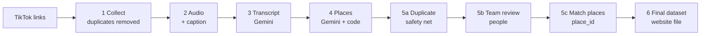

# TVNA data pipeline: how it works

_For the project supervisor. Last updated: 2026-11-18._

## 1. Goal and scope

**Goal:** turn TikTok videos about places in Phnom Penh into a clean list of places for the TvNa website. Each place has a name, category, district, Google Maps link, menu items, what creators said about it, and how many different creators posted about it.

**Scope:** TikTok videos only. Places in Phnom Penh only.

**Approach:** AI (Google Gemini) does the slow work (listening and reading). People check every place before it is published. Code checks the rules in between.

---

## 2. The stages at a glance



| Stage | Who | Input | Output | Gate (must be true to go on) |
|---|---|---|---|---|
| 1. Collect | script | TikTok links | one clip file per **new** video | TikTok link; video not collected before |
| 2. Audio | script | the clip's link | WAV audio file + the TikTok caption | the video can be downloaded and has sound |
| 3. Transcript | Gemini | the WAV | the transcript (Khmer + English) | audio exists; not reviewed by the team yet |
| 4. Places | Gemini + code | transcript + caption | one record per place, with a score and a status | transcript and caption read; not reviewed yet |
| 5a. Duplicates | script | all clip files | second copies moved aside | (safety net, always runs) |
| 5b. Review | **people** | places not yet checked | missing fields filled; status `verified` or `rejected` | a person approves it |
| 5c. Match | script | `verified` places | a `place_id` for each; the list of real places | status is `verified` |
| 6. Final | script | clips + place list | `final_dataset.json` for the website | `verified` **and** has a `place_id` |

**Data storage:** JSON files in git, one file per video (`data/clips/PP-001.json`). No database is needed at this size; git shares the data in the team and keeps every change.

### Tools used

All code is **Python 3.12**. Versions are pinned in `requirements.txt` / `requirements.lock.txt`.

| Stage | Tools | What the tool does there |
|---|---|---|
| 1. Collect | Python only (`urllib`, `re`) | expands short links, takes the video number from each link, compares it with existing clips |
| 2. Audio | **yt-dlp** 2026.10.26, **ffmpeg** | yt-dlp downloads the TikTok video and reads its caption and date; ffmpeg turns it into a 16 kHz mono WAV |
| 3. Transcript | **Google Gemini API** (`google-genai` 3.0.0): `gemini-3.8-flash`, backup `gemini-3.6-flash` | listens to the WAV, writes Khmer + English text |
| 4. Places | **Gemini API**: `gemini-3.6-flash`, backup `gemini-3.8-flash`; **pydantic** 2.14.3 | Gemini reads transcript + caption; pydantic forces a fixed JSON answer shape and rejects a broken one |
| 5a. Duplicates | Python only | compares video numbers, moves files |
| 5b. Review | **Google Maps** + a text editor | a person finds the place, its district and Share link |
| 5c. Match | Python `difflib` | scores how alike two names are (95% = same, 75–94% = unclear) |
| 6. Final | Python only (`json`) | joins clips and places.json into one file |

**Shared:** JSON files in **git/GitHub** (the data storage); **python-dotenv** 1.2.4 reads the Gemini key from `.env` (never in the code); a **venv** so everyone runs the same versions; tests in plain Python with fake TikTok and fake Gemini. Only stages 3 and 4 make AI calls (Gemini free tier).

---

## 3. Each stage

### Stage 1: Collect (and remove duplicates)

- **How it works:** takes one link or a text file of links. Short links (`vt.tiktok.com/...`) are expanded. Each link is reduced to the TikTok **video number**, which is compared with every clip already collected and with the other links in the file.
- **Input:** TikTok links. **Output:** a new clip file `PP-NNN.json` (from the clip template) with the link, video number, creator and date.
- **Conditions:** only TikTok links; a video already collected gets **no** file. `--check-only` shows the result without creating anything.
- **Why it matters:** stages 2–4 cost time and AI calls. Removing duplicates **here**, before any file exists, means no AI call is ever spent on a duplicate.

### Stage 2: Audio and caption

- **How it works:** downloads the video (yt-dlp), keeps only its sound as a 16 kHz mono WAV (ffmpeg), and deletes the video. Also saves the creator's TikTok caption and the post date.
- **Input:** the clip's link. **Output:** `data/audio/PP-NNN.wav`; `audio_file`, `source.caption`, `source.posted_at` in the clip.
- **Conditions:** the clip has a valid TikTok link; the download works; the video has sound. If anything fails, the clip is **not changed** and the reason is printed.
- **Key point:** the caption is typed by the creator, so it often spells the place name correctly. Stage 4 uses it.

### Stage 3: Transcript

- **How it works:** sends the WAV to Gemini, which writes what is said: Khmer in Khmer script, English in English, no translation. Music-only videos get `[no speech]`; song lyrics are not written.
- **Input:** the WAV. **Output:** `stt.transcript` and the model used.
- **Conditions:** the WAV exists and is valid. If Gemini is busy, it waits and retries (3 tries per model, waiting 10 s then 30 s), then switches to a backup model. If all are busy, the clip is left unchanged and listed to retry later.
- **Key point:** audio only, on purpose. The transcript keeps the name **as heard**, even if misheard; the caption's spelling is added in stage 4. Both are kept, and a person picks.

### Stage 4: Find the places

- **How it works:** Gemini reads the transcript and the caption and returns each place mentioned: name, other names, category, price, district, opening hours, menu items, opinion, and a short quote as evidence. The **code** then checks the answer:
  - the district must be one of the 14 official districts (`areas.json`);
  - the evidence quote must really be in the transcript or caption;
  - a "name" that is only a #hashtag or @account is rejected;
  - a place named only in the caption is flagged (it could be a sponsor).
- **Name rule: when the TikTok caption writes the place's name, the caption's spelling wins.** The creator types the caption, so its spelling is usually right; speech-to-text can mishear a name. The caption's spelling goes in `place_name`. Every other name (the spoken or misheard one, a Khmer name) goes in `place_name_alt`, so nothing is lost. Example: the speaker says "Hanjang Coffee & Eatery", the caption writes "Hanjan Coffee" → `place_name` = "Hanjan Coffee". A person can still change it in review (5b).
- **Score and status:** `completeness` = how many of the 3 key fields are filled (name, district, opinion) out of 3.

  | Result | Status |
  |---|---|
  | no name, a tag-only name, or score below 0.3 | `rejected` (kept, not deleted) |
  | score 0.7 or below (1 or 2 of 3 filled) | `needs_review` |
  | all 3 filled | `auto_added`, but `needs_review` if the transcript doesn't back the name |

- **Input:** transcript + caption. **Output:** `fields` in the clip (one record per place), and an untouched copy of Gemini's answer in `data/gemini_answers/` to measure AI mistakes later.
- **Conditions:** a transcript exists and the caption has been read. A clip the team already reviewed is **never** redone, even when forced.

### Stage 5a: Duplicate safety net

- **How it works:** compares the video number of all clip files. If two files are the same video (e.g. a file copied by hand), it keeps the real one and moves the other to `duplicates/`. Nothing is deleted.
- **Key point:** a second layer; stage 1 already stops most duplicates.

### Stage 5b: Team review (people)

- **How it works:** a person opens each place that is not `verified` yet. Three fields tell them what to do: `missing_fields` (what to fill), `flags` (what to double-check, e.g. "name from caption", "uncertain spelling") and `google_maps_url` (always found by a person). They check the name, find the place on Google Maps, pick the district from the address, sign with `cleaned_by`, and set `verified` or `rejected`.
- **Condition to go on:** status `verified`. **Nothing reaches the website without a person's approval.**
- **Key point:** the AI suggests, a person decides. A misheard name can never reach the website unchecked.

#### Location: `area`, `area_description`, `google_maps_url`

Three fields hold where a place is:

| Field | What it holds | Filled by |
|---|---|---|
| `area` | the **district**, always one of the 14 names in `data/areas.json` (a list, for branches) | stage 4, only if the video or caption names a district; otherwise the team |
| `area_description` | any words about the location, as said or written: street, landmark, neighborhood, "📍…" | stage 4 |
| `google_maps_url` | the Google Maps Share link | **always the team** (the AI never fills it) |

Stage 4 puts a value in `area` only if it **exactly** matches a district in `areas.json`, in English or Khmer (ចំការមន = "Chamkar Mon"). Anything else (a street, a landmark, "BKK1") goes to `area_description`. If Gemini puts a non-district in `area`, the code moves it to `area_description` and adds the flag `area_not_in_areas_list`.

What the team does in 5b, by case:

| Case | Example after stage 4 | Team does |
|---|---|---|
| **A. A district is named** | `area: ["Chamkar Mon"]` | confirm it on Google Maps; add the Share link |
| **B. Only a street, landmark or neighborhood** | `area: null`, `area_description: "located on street 216 near National Olympic Stadium"` | search Google Maps with the name + `area_description`; check it's the right place (name, photos); take the district from the Maps **address** and write it exactly as in `areas.json`; add the Share link |
| **C. Nothing about the location** | `area: null`, `area_description: null` | search Google Maps by the place name, plus clues from the video (signs, the caption, the creator's other posts); then as in B |
| **D. Not found on Google Maps** | still `null` | leave `area` and `google_maps_url` as `null`; write what was tried in `cleaner_note`. **Keep the status `needs_review`**: held back, not on the website; anyone can try again later |

Why the Maps link matters: stage 5c matches places by Maps link first, so two videos of the same shop join even when the names are spelled differently. 5c copies the link into `places.json` when it creates the place.

### Stage 5c: Match places (`place_id`)

- **How it works:** many videos show the same shop, often spelled differently. 5c gives each verified place a `place_id` and keeps one list of real places (`places.json`) with all their names. In order:
  1. same Google Maps link → same place;
  2. same name or known other name → same place;
  3. 95% similar name (not for Khmer) → same place, new spelling remembered;
  4. 75–94% similar, or a close Khmer name → **unclear**: a person decides;
  5. otherwise → a new place.
- **Input:** `verified` places. **Output:** `place_id` in each clip; `data/places.json`.
- **Key point:** when unsure, it asks a person instead of guessing. Every confirmed name is remembered, so the next video matches exactly.

### Stage 6: Final dataset

- **How it works:** groups all clips by `place_id` into one record per place: one name, all categories, districts, menu items, every creator's opinion, and `popularity` = number of **different creators**.
- **Input:** clips + `places.json` + `areas.json`. **Output:** `data/final_dataset.json`.
- **Conditions:** only `verified` places with a `place_id`. Warnings list what was left out and where clips disagree (e.g. two different price ranges).
- **Key point:** one name per place on the website. Other spellings stay inside the pipeline for matching only.

---

## 4. Where files go when a condition is not met

```
data/
├── clips/                ← every collected video, whatever its status
│   └── duplicates/       ← second copies of a video (moved by 5a, never deleted)
├── audio/                ← WAVs from stage 2 (on each computer, not in git)
├── gemini_answers/       ← Gemini's first answer per clip (never edited)
├── areas.json            ← the 14 districts (fixed)
├── places.json           ← one entry per real place (only verified places)
└── final_dataset.json    ← the website file (only verified places with a place_id)
```

**Status lives inside the clip file, not in folders.** One video can show several places, and each place has its own status (one `verified`, another `rejected`). So the clip file stays in `data/clips/`, and each place carries its own `verification_status`. Only whole-file duplicates move to another folder.

| Condition | What happens | Where the file is |
|---|---|---|
| **Bad link** (not TikTok, short link can't be opened) | stage 1 lists it under "bad links"; no file | nowhere: it never enters |
| **Duplicate found in stage 1** | stage 1 lists it as "same video as PP-00N"; no file | nowhere: no file, no AI cost |
| **Duplicate found later** (e.g. a file copied by hand) | 5a keeps the real one and moves the copy, adding `"duplicate_of": "PP-00N"` | `data/clips/duplicates/` (stage 1 still sees it, so the video is never collected again) |
| **A stage fails** (download failed, Gemini busy, video deleted) | the clip is not changed; the reason is printed; run the stage again later | `data/clips/`, stuck at the last stage that worked |
| **No speech and no caption** | stage 4 has nothing to read, so it skips the clip | `data/clips/`, no places |
| **`rejected`** (no name, only a #tag, not a place, outside Phnom Penh) | kept in the clip, never deleted; skipped by 5c and 6 | `data/clips/` (status inside) |
| **`needs_review` / `auto_added`** (not checked by a person yet) | 5c lists it as "waiting for review"; 6 leaves it out | `data/clips/` (status inside) |
| **Not found on Google Maps** | stays `needs_review` with a `cleaner_note` (held back) | `data/clips/` (status inside) |
| **`verified`, but unclear match** | 5c leaves `place_id` null and suggests one; a person decides | `data/clips/`; not in `places.json` yet |
| **`verified` and matched** | gets a `place_id`; published | clip in `data/clips/` + entry in `places.json` + record in `final_dataset.json` |

**Nothing is ever deleted** by the pipeline: rejected places stay in their clip, duplicates are moved, and git keeps every earlier version. To undo a duplicate move, move the file back.

**To find places by status:**

```sh
grep -l '"needs_review"' data/clips/*.json     # waiting for a person
grep -l '"rejected"' data/clips/*.json         # rejected places
grep -l '"verified"' data/clips/*.json         # approved
ls data/clips/duplicates/                      # duplicates
```

---

## 5. One video, start to finish (real clip PP-002)

| Stage | Result |
|---|---|
| 1 | `PP-002.json`, creator `@motokhiev.bydm` |
| 2 | 73.3 s WAV; caption ends "…🛵Hanjan Coffee" |
| 3 | 30-line Khmer/English transcript; the speaker says "Hanjang Coffee & Eatery" |
| 4 | place "Hanjan Coffee" (caption spelling), other name "Hanjang Coffee & Eatery" kept; area "Toul Tompoung area" but no district → score 0.67, `needs_review`, flag `name_from_caption` |
| 5b | waiting: a person must find the district and the Maps link, then approve it |
| 5c, 6 | will run after approval |

---

## 6. Key takeaways

1. **People approve everything that is published.** The AI fills, the code checks, a person decides. Only `verified` places reach the website.
2. **Duplicates are removed first**, at stage 1, so no AI calls are wasted on them.
3. **The caption's spelling wins.** When the TikTok caption writes the place's name, that spelling becomes the name; the heard spelling is kept as another name for matching, never shown on the website.
4. **Nothing is lost.** Every name the AI hears or reads is kept; Gemini's first answer is saved untouched; clips are moved, never deleted; every change is in git.
5. **Uncertain cases go to a person**, not a guess: unclear place matches, names only in the caption, tag-only names, districts not on the official list.
6. **Each stage is a small separate command** that prints what it did and stops, so results can be checked step by step. Re-running a stage changes nothing and costs nothing.
7. **Tested without cost:** 323 automatic checks with fake TikTok and fake Gemini, run before every update. Each "already done, skip" rule is tested with filled, empty and missing values.
8. **Built to measure itself later:** comparing Gemini's saved first answer with the team's corrections shows where the AI is wrong (planned: a score per prompt change).

---

## 7. Current status and limits

**Built and tested:** all stages (1–6). Stage 5b is done by hand with a written checklist.

**Real data so far:** 2 clips through stage 4 (PP-002, PP-003); none reviewed yet.

**Decided 2026-11-18:** a place the team can't find on Google Maps is held back (`needs_review` + `cleaner_note`), not published and not rejected. The website filters by district, so a place with no district would be hard to find.

**Known limits:**
- Places outside Phnom Penh are not rejected automatically yet; the team rejects them in review.
- The completeness score is not recalculated after the team fills fields.
- Two people collecting at the same time on different computers can get the same clip number. Rule: `git pull` first, push soon after.
- Gemini is often busy (errors 503/504); stages 3–4 then wait or switch model, which can take minutes.
- Fixing a wrong place match needs two manual edits (the clip and `places.json`).

**Next, in order:**
1. Stages 2–4 refuse a hand-copied clip file before any AI call.
2. A review helper for 5b that lists every place to check and what is missing.
3. Learn from the team's fixes: save them, give known names to Gemini as hints, and measure accuracy on reviewed clips.
4. Automatic Phnom Penh check in stage 4.
5. Later: view/like counts for ranking; automatic tests on every push (CI).
